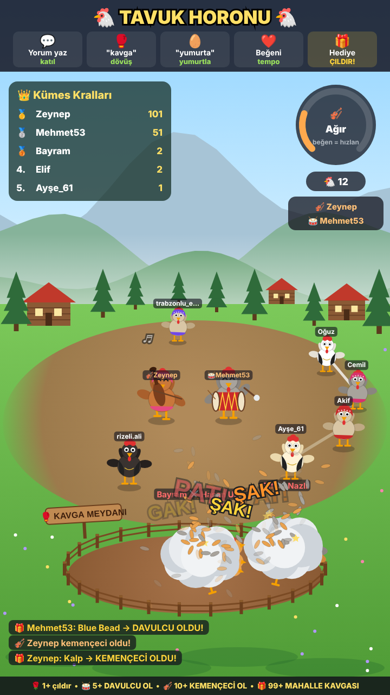
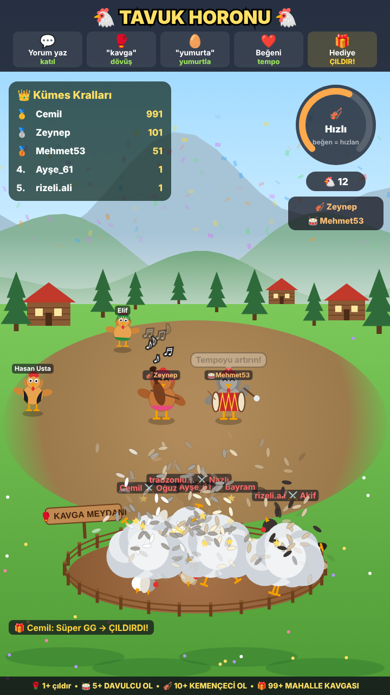
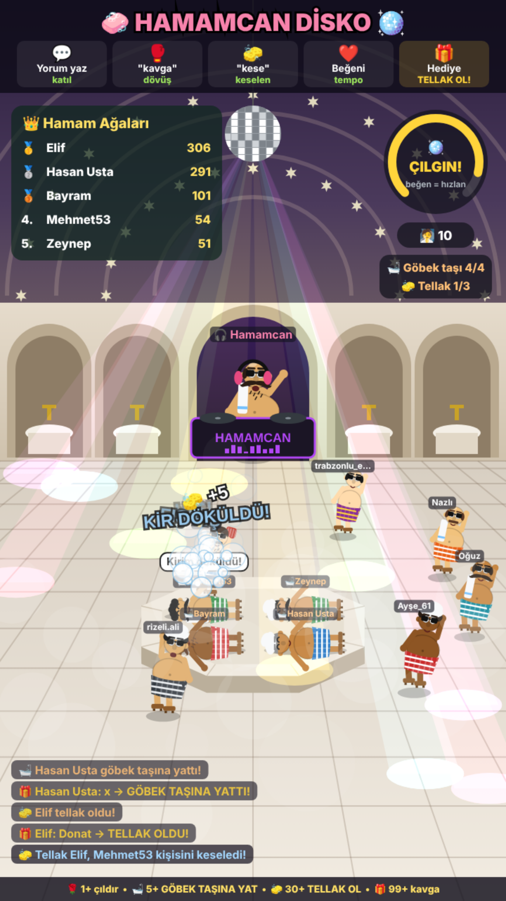
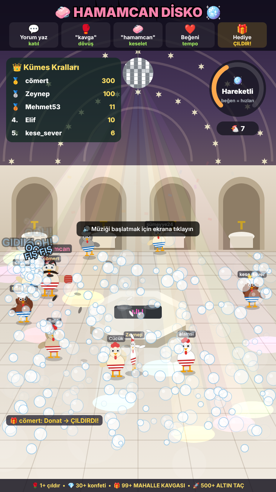

# 🐔 Kümes Sahnesi: TikTok Canlı Yayın Oyunu

İzleyicilerin yorum, beğeni ve hediyeleriyle yönettiği tavuk oyunu. İki sahnesi var:

- **Tavuk Horonu** (açılışta gelen sahne): Yaylada tavuklar kanat kanada tutuşup 7/16 aksak ritimle horon teper.
  Ortada **kemençeci** ve **davulcu** yan yana çalar; izleyiciler hediyeyle bu rolleri kapabilir.
  Kavgalar halkanın altındaki çitli **Kavga Meydanı**'nda olur, horon bozulmaz.
  Tempo yükselince tavuklar meşhur "titreme"ye geçer.
- **Hamamcan Disko**: Hamamda disko! Bu sahnede herkes **peştemallı bir adam** olur (nalın, havlu, bıyık, göbek).
  DJ kabininde pala bıyıklı **Hamamcan** çalar, tavanda disko topu döner. Hamamcan ara sıra kabinden tasla
  soğuk su atar. Hediye atan **göbek taşına yatabilir** ya da **tellak olup** başkalarını keseleyebilir.

| Tavuk Horonu | Mahalle Kavgası | Hamamcan Disko | Tellak ve köpük |
|---|---|---|---|
|  |  |  |  |

## İzleyici ne yapınca ne olur?

| İzleyici | Oyunda |
|---|---|
| Yorum yazar | Kendi adıyla bir tavuk halkaya katılır, yorumu konuşma balonunda çıkar, zıplar |
| `kavga` yazar | Tavuğu rastgele birine dalar. `kavga @isim` yazarsa o kişiye dalar. Toz bulutu, POW/GÜM, uçuşan tüyler; kaybeden bayılır |
| `yumurta` yazar | Tavuğu gıdaklayarak yumurtlar |
| `kese` yazar (hamam) | Tellaklardan biri gelip onu keseler. Tellak yoksa "30 jeton at, tellak ol" der |
| `hamamcan` yazar (hamam) | Hamamcan kabinden ona tasla soğuk su atar |
| `çıldır` yazar | Tavuğu birkaç saniye çıldırır (20 sn bekleme süresi var) |
| Beğeni | Tempo göstergesi dolar, müzik ve dans hızlanır |
| Hediye (1+ jeton) | Gönderenin tavuğu ÇILDIRIR: deli gibi koşar, kanat çırpar, tüy saçar. Jeton arttıkça süre uzar |
| 30+ jeton | Konfeti, herkes zıplar. Hamamcan Disko'da ayrıca **KÖPÜK PARTİSİ** başlar |

### Tavuk Horonu'na özel roller

| Hediye | Rol |
|---|---|
| 1-4 jeton | Tavuğu çıldırır |
| **5-98 jeton** | **Davulcu olur** (3 dk). Tokmakla 2+2+3 vuruşlarında davula vurur |
| **10-98 jeton** | **Kemençeci olur** (3 dk) |
| 99+ jeton | **Mahalle kavgası**: tavuklar ikişer ikişer Kavga Meydanı'na iner |

Her çalgıda tek kişi çalar: **son hediye atan çalgıyı kapar**, önceki çalgıcı "Davulumu kaptılar! 😤" diyerek
halaya döner. Aynı kişi tekrar atarsa süresi uzar. Çalgı boşken NPC Kemençeci Horoz ve Davulcu Horoz çalar.
Sağdaki kutuda o an kimin çaldığı ya da kaç jetona alınabileceği yazar. `davul` / `kemençe` yazana fiyatı söylenir.

### Hamamcan Disko'ya özel roller

| Hediye | Rol |
|---|---|
| 1-4 jeton | Çıldırır, deli gibi dans eder |
| **5+ jeton** | **Göbek taşına yatar** (60 sn, tekrar atınca uzar). 4 yer var; dolunca en eski kalkar |
| **30+ jeton** | **Tellak olur** (2 dk): eline kese, omzuna havlu alır. Önce göbek taşında yatanları, sonra "kese" yazanları keseler. Her keseleme +5 puan. En fazla 3 tellak |

Rolleri olanlar kavgaya girmez ("Şimdi işim var!"). Sahne Tavuk Horonu'na dönünce roller biter.
| 99+ jeton | **MAHALLE KAVGASI** (herkes birbirine girer) veya **TOPLU ÇILGINLIK**. 300+ jetonda ikisi birden |
| 500+ jeton | Havai fişek ve kalıcı **altın taç**. Altın taçlı tavuk kavgalarda daha güçlüdür |
| Takip / Paylaşım | Kalpler / yumurta yağmuru |

Ayrıca her 20-30 saniyede bir rastgele iki tavuk kendiliğinden kavgaya tutuşur.
Hediye gönderenler kavgalarda daha şanslıdır. Lider tablosunda (Kümes Kralları) puanlar görünür.

## Kurulum

1. [Node.js](https://nodejs.org) LTS sürümünü kurun.
2. **Windows:** `canli-oyun` klasöründeki **`baslat.bat`** dosyasına çift tıklayın.
   Paketleri kurar, sunucuyu başlatır ve kontrol panelini açar.
   **Mac/Linux:** `npm install` ve ardından `npm start` komutlarını çalıştırın.
3. TikTok'ta canlı yayını başlatın.
4. Kontrol panelinde (`http://localhost:8080/panel`) kullanıcı adınızı yazıp **Bağlan**'a basın.

## Yayına ekleme

- **OBS / Streamlabs:** Kaynak ekle → *Tarayıcı* → URL `http://localhost:8080`, genişlik **720**, yükseklik **1280**.
  "Sesi OBS üzerinden kontrol et" kutusunu işaretlerseniz müzik yayına gider.
- **TikTok LIVE Studio:** Chrome'da `http://localhost:8080` adresini ayrı bir pencerede açın, pencereyi dikey yapın ve
  *Pencere yakalama* ile ekleyin. Müziğin başlaması için oyun ekranına bir kez tıklayın.

Kontrol panelini ayrı bir sekmede tutun. Sahne değiştirme, demo modu ve deneme olayları oradadır.
Yayına çıkmadan önce **Demo** kutusunu açarak oyunu sahte izleyicilerle deneyebilirsiniz.

Oyun ekranı kısayolları: **M** sahne değiştir, **D** demo, **S** ses, **1-9** deneme olayları (8: 5 jeton, 9: horonda 10, hamamda 30 jeton).
Adres sonuna `?mod=hamam` eklenirse Hamamcan Disko ile başlar, `?demo=1` eklenirse demo açık başlar.

## Bağlantı sorunları

TikTok'un resmî bir canlı yayın API'si yok. Bağlantı açık kaynak
[tiktok-live-connector](https://github.com/zerodytrash/TikTok-Live-Connector) kütüphanesiyle kurulur.
İmza sunucusu reddederse [eulerstream.com](https://www.eulerstream.com)'dan ücretsiz API anahtarı alıp
`ayarlar.json` dosyasına şöyle yazın:

```json
{ "kullanici": "tiktok_adiniz", "eulerApiKey": "ANAHTAR" }
```

## Dosyalar

```
server.js          TikTok köprüsü + web sunucusu (port 8080)
public/index.html  Oyun ekranı (yayına eklenen sayfa)
public/panel.html  Kontrol paneli
public/oyun.js     Oyun: tavuklar, dans, kavga, sahneler, arayüz
public/ses.js      Kodla üretilen müzik (horon ve disko) ve efektler
```
